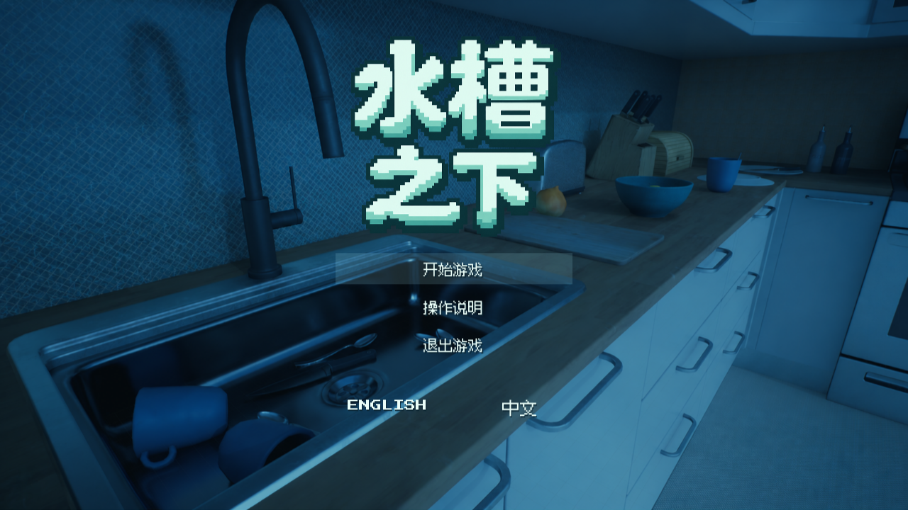
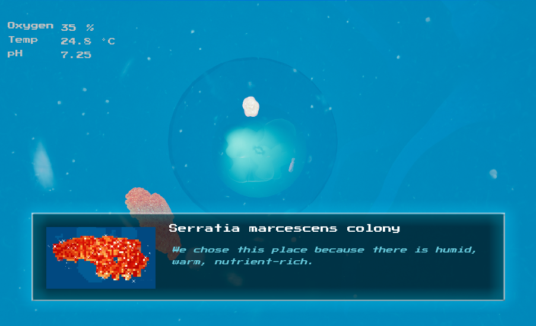

# Beneath the Sink · 水槽之下

一款面向青少年的微生物科普探索游戏。从厨房水槽出发，进入蓝色的水管世界，认识不同微生物，穿过污膜、借助水流，探索水槽之下的微观世界。

An educational exploration game about microorganisms. Begin at a kitchen sink, venture into a blue underwater pipe network, meet its microscopic inhabitants, and explore through dialogue, short bursts of movement, and flowing water.

## 下载 / Download

**Windows 64-bit · English / 简体中文**

[下载最新版 / Download the latest release](https://github.com/hotcatmiaomiaomiao-arch/Beneath-the-Sink/releases/latest)

在 Releases 的 **Assets** 中下载 `BeneathTheSink-Windows-v3.zip`，完整解压，再运行 `Beneath the Sink.exe`。请保留旁边的 `Engine` 和 `Microorganism` 文件夹，不要只移动 EXE。无需安装 Unreal Engine。

Download `BeneathTheSink-Windows-v3.zip` from the release **Assets**, extract the entire archive, and run `Beneath the Sink.exe`. Keep the `Engine` and `Microorganism` folders alongside it. Unreal Engine is not required.

GitHub 自动生成的 **Source code (zip/tar.gz)** 只有本仓库的介绍文件，不是游戏安装包。

The automatically generated **Source code** archives contain this repository's documentation, not the playable game.

## 操作 / Controls

厨房场景的操作请查看游戏开始界面的操作说明。水管场景：

| 按键 / Key | 操作 / Action |
| --- | --- |
| W / A / S / D | 前后左右移动 / Move |
| Space | 上升 / Ascend |
| Ctrl | 下降 / Descend |
| Shift | 短暂加速、穿过污膜 / Short burst, pass through slime barriers |
| F | 继续或结束对话 / Advance or finish dialogue |
| Esc | 退出游戏 / Quit the game |

在开始界面可切换中文和英文。结束后可重新开始，或返回主菜单。

Choose English or Chinese on the title screen. At the end, restart the game or return to the main menu.

## 启动问题 / Troubleshooting

- 缺少 Microsoft Visual C++ 运行库：运行游戏文件夹内的 `Engine/Extras/Redist/en-us/vc_redist.x64.exe`。
- 默认 DirectX 12 模式无法启动：尝试 `Compatibility Mode.bat`（DirectX 11，画面可能略有差别）。
- 发现问题时，请在本仓库 Issues 中附上游戏版本、系统信息、问题描述和截图。

If the Visual C++ runtime is missing, install the bundled runtime listed above. If the default DirectX 12 mode cannot start, try `Compatibility Mode.bat`; lighting may differ in DirectX 11. Report issues with the game version, system information, reproduction steps, and a screenshot.

## 关于本仓库 / About this repository

这是游戏成品的介绍与下载仓库。这里只提供编译后的 Windows 游戏，不公开可编辑的 Unreal 工程、蓝图或原始美术资源。

This repository hosts the game description and playable Windows releases. The editable Unreal project, Blueprints, and original art assets are not published here. This is not an open-source game release.

游戏内第三方音效、字体的来源和授权说明随下载包的 `Licenses` 文件夹提供；各自授权继续适用。

Third-party audio and font notices are included in the game's `Licenses` folder and remain governed by their respective licenses.

Created by [hotcatmiaomiaomiao-arch](https://github.com/hotcatmiaomiaomiao-arch). Built with Unreal Engine 5.6.
